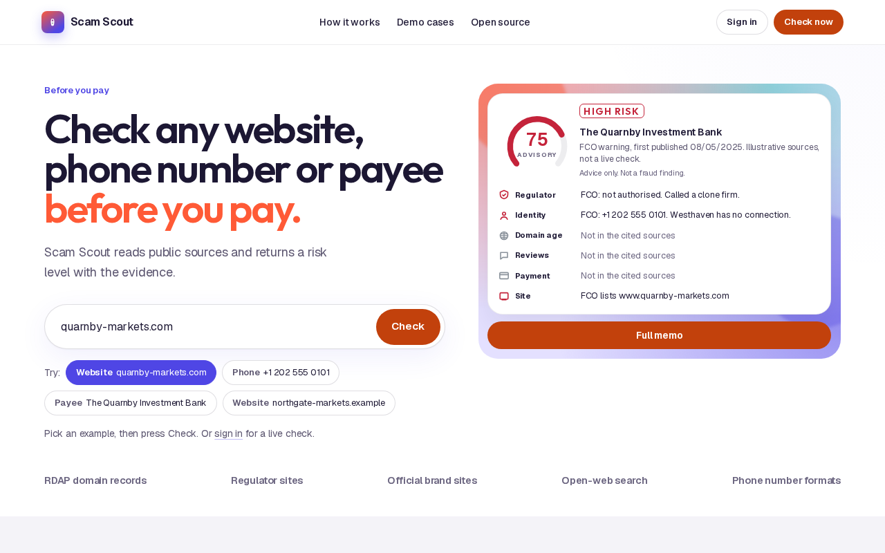
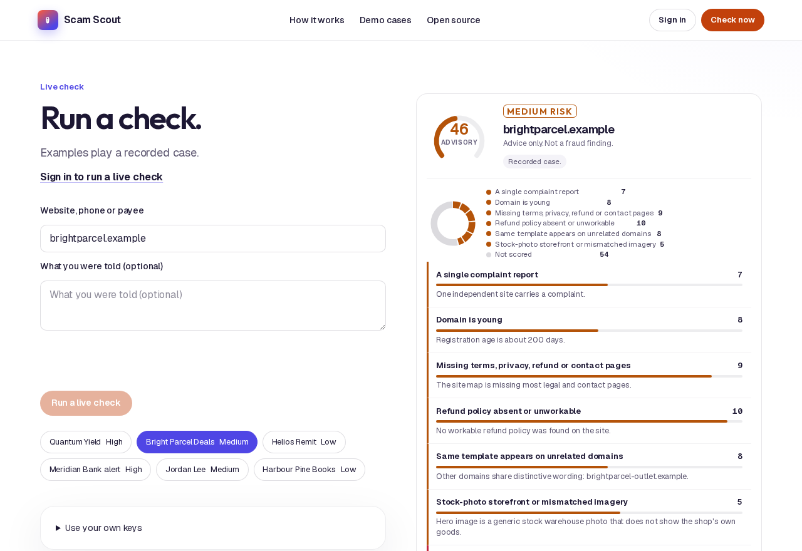
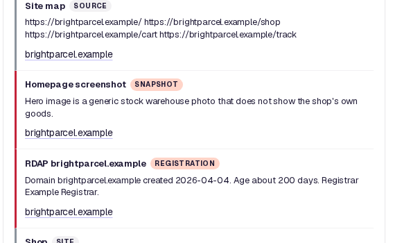
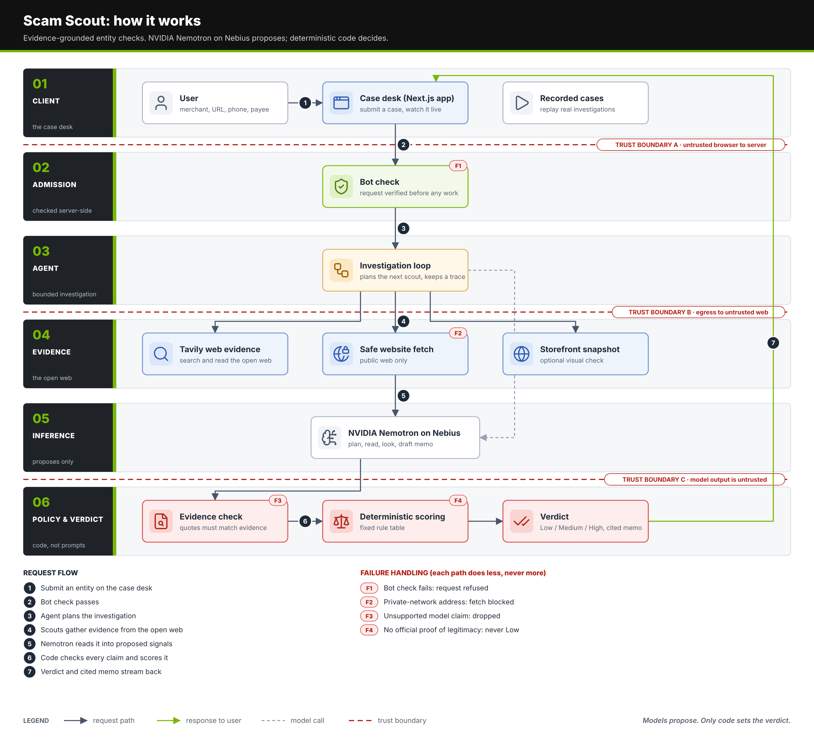

# Scam Scout

Check a website, merchant, phone number, or payee before you pay. Scam Scout gathers public web evidence, highlights warning signs, and presents a cited risk assessment with practical next steps. Results are advice, not a fraud finding.

Explore the [source code](https://github.com/Melvinroy/scam-scout). Try the [live demo](https://scam-scout-neon.vercel.app), or explore the recorded example cases.

Built with NVIDIA Nemotron on Nebius Token Factory.

## Screenshots

The home page, a recorded demo case, and its registration evidence:





## How it works

1. Enter the website, phone number, merchant, or payee you want to check.
2. The investigation gathers relevant public sources and website evidence.
3. NVIDIA Nemotron proposes findings. Code checks the supporting evidence and applies a fixed scoring rubric.
4. The case desk shows the assessment, cited sources, and suggested next steps. Recorded cases let you explore the experience locally.



## Run locally

Use Node.js 22 and npm.

```sh
npm ci
cp .env.example .env.local
npm run dev
```

Open <http://localhost:3000>. Start with the recorded demo cases; additional integrations are configured through `.env.example`.

Run the checks:

```sh
npm run lint
npx tsc --noEmit
npx vitest run
npm audit --omit=dev
```

## Licence

[MIT](LICENSE) © 2026 Melvin Roy. Dependencies and assets retain their respective licences; see [third-party notices](THIRD_PARTY_NOTICES.md). To report a vulnerability, see [security policy](https://github.com/Melvinroy/scam-scout/security).
